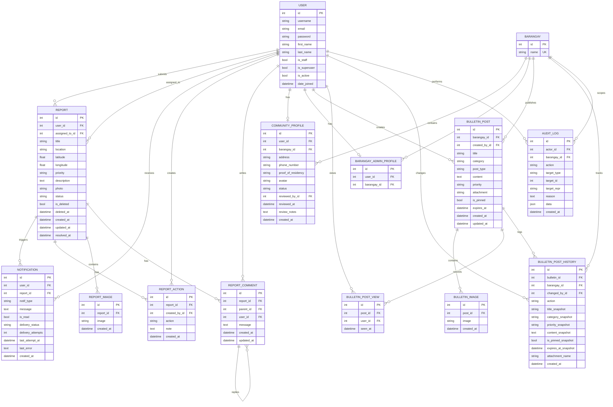

# i-Sumbong Entity Relationship Diagram

This ERD is based on the Django models in `base/models.py`.

## Relationship Notes

- `User` is Django's built-in auth user table.
- `CommunityProfile.user` and `BarangayAdminProfile.user` are unique one-to-one links to `User`.
- `Report.assigned_to` is optional and points to the admin user assigned to handle the report.
- `ReportComment.parent` is a self-reference for threaded replies.
- `BulletinPostView` has a unique pair of `post` and `user`, so each user can be counted once per bulletin.
- `AuditLog.target_type` and `target_id` behave like a lightweight polymorphic reference to different system records.
